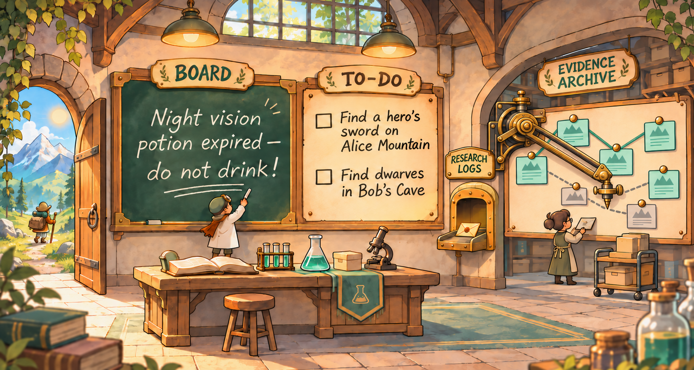
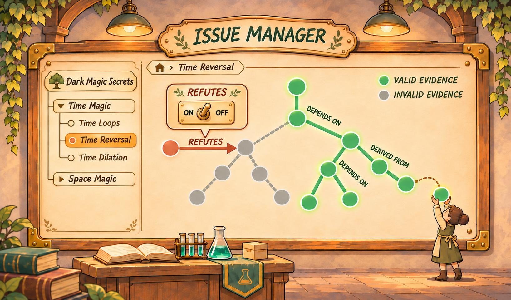
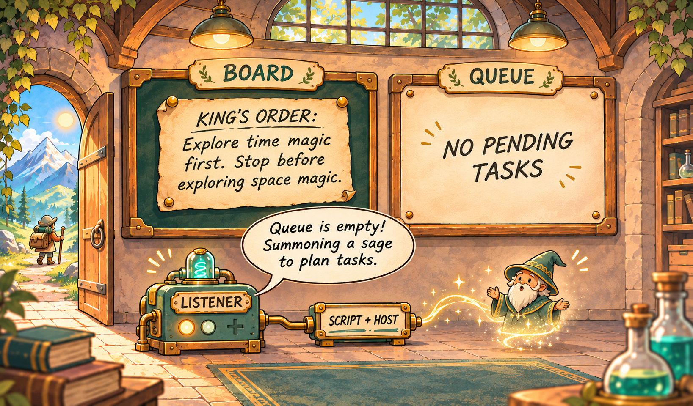

# Fieldstation

[简体中文](README.md) | **English**

**Infrastructure for human–AI collaboration in scientific research**

Fieldstation was designed and developed by Yi-Han Yu.

Research can last months or years, while an AI agent session can address only a small part of it. Experiments fail, directions change, conclusions face new evidence, and participants move on. How can observations, analyses, and challenges accumulate so that people and agents can continue from earlier work?

Fieldstation explores this question. It organizes research questions, evidence, and conclusions, and uses explicit relationships and rules to calculate the effects of changing evidence. It also offers task, communication, material intake, and optional session-launch tools to help people and agents share findings and continue research.

This is an early research prototype. This public version presents its design and current implementation; it is not a complete, effortless-to-deploy research product. The examples below are fictional.

## From changing evidence to maintaining conclusions

Suppose a team asks whether **treatment A reliably improves an experimental outcome**:

1. An observation E1 supports a provisional conclusion, and its author explicitly adopts E1 as evidence.
2. A replication E2 produces a different result. After reviewing it, a participant explicitly records that E2 refutes E1.
3. The team discovers that E2 used a faulty cable. A participant judges that new evidence E3 refutes E2. Further replications and challenges may follow.

Participants can add local findings, declare relations, or withdraw and restore existing relations without manually editing the entire chain. Issue Manager (IM) computes evidence eligibility—available, unavailable, or undecided—from explicitly declared necessary dependencies and refutations. When relevant inputs change, it compares the current evidence with the precise materials adopted by a conclusion and maintains the currentness and reasons for affected conclusions. Effects can also propagate through dependencies between conclusions.

The switch in the illustration represents withdrawing and restoring a relationship; it is not a screenshot of the current interface. Green and gray represent available and unavailable evidence; actual calculations can also be undecided.

A refutation of a refutation can change earlier eligibility. The system preserves prior records and conclusion history, helping participants identify conclusions to reconsider. People and agents remain responsible for scientific judgments and for deciding what relationships to declare. New evidence is not automatically adopted into a conclusion: an author must explicitly choose it and save a new conclusion. Restored evidence eligibility does not automatically reinstate an old conclusion.

IM distinguishes provenance, necessary dependency, refutation, and challenge. A provenance link alone does not make a source a necessary premise; a challenge alone does not automatically exclude its target. See [Evidence and current basis](docs/en/evidence.md) and [IM internals](docs/en/im-internals.md).

This mechanism has an explicit **mathematical calculation contract**: for a fixed evidence snapshot, it solves necessary dependencies and refutations together using a three-valued least-information fixed point, retaining undecided states where they cannot be resolved. It also defines the closure of a conclusion’s adopted evidence and how changes are compared. See the [mathematical contract: unified management semantics](docs/en/calculation-contract.md) for the equations, properties, and limits.

**Inbox offers a lower-friction intake path.** An experimenter can record inputs, methods, conditions, observations, failures, and open questions before splitting evidence and declaring every relationship. A person or agent can later curate the materials, identify sources, and decide which relationships to record. Intake does not itself create curated evidence or establish a scientific conclusion.

## Adding optional automation to human–agent collaboration

Researchers can ask questions, plan and conduct experiments, record findings, curate evidence, and judge conclusions. Agents can take on parts of this work. Fieldstation provides the records, tasks, and communication tools, and lets a project optionally connect discovery and session launch to help work continue between participants and sessions. **People can participate at any step.**

The illustration shows one optional policy: Listener discovers Queue state read-only; a trusted script chooses when to ask Host to start a session. Whether an empty Queue should launch a sage is a project decision.

**Queue** can hold separate experimental tasks for different participants. **Board** can carry a message such as “Cable 2 is damaged; do not use it” or an explicit human instruction. The **read-only console** lets people browse questions, evidence, messages, and tasks. Claiming a task does not prove that an experiment is complete; message delivery does not prove that everyone acted on it.

Modules can be used independently or connected as needed. People and independent sessions can still contribute when automatic launching is off. Saving materials requires no prior task, and research does not have to follow a fixed role sequence. A role name or work focus does not grant permissions.

## Status

Fieldstation includes Issue Manager, independent orchestration tools, and an initial read-only console. Long-term research outcomes, agent role performance, scientific quality, real device integration, physical cross-machine operation, and production deployment remain to be validated.

The current source versions are Issue Manager 0.9.0rc11, schema 10, and orchestration 0.13.8. Connecting real models, instruments, and external scientific tools requires additional configuration and validation.

## Try it and learn more

The console contains fictional sample data and needs no model, API key, or running service. With Python 3.11 or newer, run `python fieldstation_console/server.py` from the repository root, then open <http://127.0.0.1:18765/>. Stop with Ctrl+C. The sample is not a live project. See the [console documentation](docs/en/console.md) for live connection limits.

- [Design ideas](docs/en/design-ideas.md) · [English documentation](docs/en/README.md) · [Architecture](docs/en/architecture.md) · [Mathematical contract](docs/en/calculation-contract.md)
- [Evidence and Inbox](docs/en/evidence.md) · [Orchestration](docs/en/orchestration.md) · [Getting started](docs/en/getting-started.md)
- [Contributing](docs/en/contributing.md) · [Changelog](docs/en/changelog.md) · [MIT License](LICENSE)

Code is in `issue_manager/`, `orchestration/`, `fieldstation_console/`, and `project_package/`.

## Acknowledgments

I would like to express my sincere gratitude to Jia-Qi Cai for his thoughtful discussions and valuable suggestions on this project.

