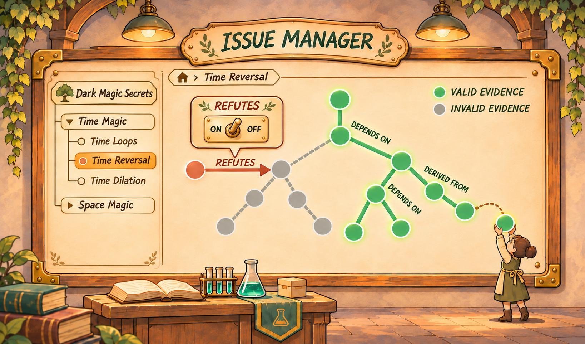
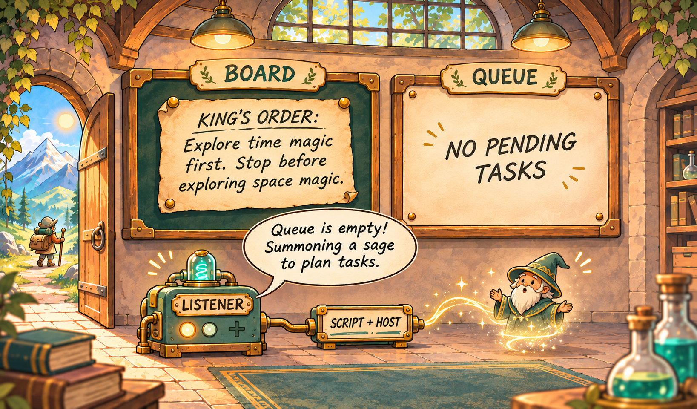

# Fieldstation

**简体中文** | [English](README.en.md)

**面向科学研究的人与 AI Agent 协作基础设施**

Fieldstation 由 Yi-Han Yu 设计和开发。

科学研究往往持续数周、数月甚至更久，而一次 Agent 会话只能处理其中一小部分。实验会失败，研究方向会调整，结论会受到新的证据挑战，参与者也可能更换。怎样让每次观察、分析和质疑积累下来，并让后来的人和 Agent 能够在已有工作的基础上继续研究？

Fieldstation 是对这一问题的探索。它将研究问题、证据与结论组织起来，用明确的关系和规则计算证据变化的影响；同时提供待办、交流、材料收集和可选的会话启动工具，支持人和 Agent 分别开展工作、共享发现并接续研究。

这是一个早期研究原型，公开版本主要展示设计和当前实现，并非开箱即用的完整科研产品。下文的实验场景均为虚构示例。

## 从证据变化到结论维护

假设一个团队在研究**处理方法 A 是否能稳定改善实验结果**。研究结果可能反复受到支持、质疑和复核，例如：

1. 一次观察 E1 支持方法 A 的阶段性结论，作者明确选用它作为依据。
2. 新的复现实验 E2 没有得到相同结果。参与者审查后，明确记录 E2 对 E1 的反驳关系。
3. 后来发现 E2 使用的线缆有问题；经研究者判断，新的材料 E3 对 E2 构成有效反驳。随后还可能有更多复测和争议。

IM 不只是把这些材料存成一串笔记。参与者可以围绕局部发现添加 Evidence、声明关系或撤回、恢复已有关系，不必手工修改整条证据链。IM 根据参与者**明确声明**的必要依赖和反驳关系，计算相关 Evidence 的资格，例如可用、不可用或未决；当相关输入变化时，再把当前依据与结论当时采用的准确材料比较，维护受影响结论的当前性和原因。依赖其他结论的影响也会按规则传播。

图中的开关是关系撤回与恢复的示意，并非现有界面的截图。图中绿色和灰色分别表示可用与不可用；实际计算也可能产生未决状态。

因此，对反驳的进一步反驳可以改变先前证据的计算结果。系统保留此前记录和结论历史，帮助参与者发现哪些结论需要重新审视，而不是要求人手工遍历全部关联。结论是否在科学上成立、材料之间应建立什么关系，仍由参与者判断。新材料出现也不会自动成为结论的依据；作者需要明确采用并保存新结论。证据资格恢复不等于自动恢复旧结论。

IM 还区分**来源、必要依赖、反驳和争议**：例如记录材料来源并不自动意味着它是必要前提；一般争议也不会单独自动排除被质疑的证据。详细规则及边界见 [Evidence 与当前依据](docs/EVIDENCE_MANAGEMENT.md) 和 [IM 内部计算](docs/IM_INTERNAL_ARCHITECTURE.md)。

这套机制有明确的**数学计算契约**：它在固定证据快照上，以三值最小信息不动点共同求解必要依赖与反驳，并保留无法确定的状态。契约还定义了结论依据闭包及变化比较；公式、性质与适用边界见[数学契约：统一管理语义](docs/UNIFIED_MANAGEMENT_SEMANTICS.md)。

为了减轻实验员的记录负担，**Inbox 提供一个先交材料、再整理入账的入口**。实验员可以先记录实验输入、方法、条件、观察、失败和未决问题，而不必在实验时完成全部证据拆分和关系整理。之后由人或 Agent 按实际内容整理 Evidence、标明来源并判断需要建立哪些关系。这样可以降低现场录入的复杂度，减少遗漏或会话中断造成的材料丢失风险；提交 Inbox 本身不等于材料已经整理或科学结论已经成立。

## 给人与 Agent 的协作加上自动推进

研究者可以提出问题、安排实验、记录结果、整理证据和判断结论；Agent 可以在其中承担部分工作。Fieldstation 提供记录、待办和交流工具，并允许项目按需连接自动发现与会话启动，让工作在参与者和会话之间更容易接续。**人可以参与任意环节**：手动发布待办、提供材料、开展实验、整理证据或作出判断，也可以选择让配置好的 Agent 承担其中一部分。

图中展示的是一种可选配置：Listener 只读发现 Queue 的状态，脚本根据项目选择的条件请求 Host 启动会话。Queue 没有待办时是否启动智者，由项目自行决定。

例如，**Queue** 可以存放多条实验路线的待办，供不同参与者领取；**Board** 可以交流“2 号线缆损坏，暂时不要使用”等现场信息或人类指令。**只读工作台**帮助人浏览研究问题、依据、交流和待办。领取待办不表示实验已完成，消息送达也不表示所有人已经采取行动。

各模块可以分别使用，也可以按项目需要连接。自动启动关闭时，人和独立会话仍可以使用这些工具；材料保存不要求先建立待办，研究也不必经过固定的岗位顺序。岗位名称和工作焦点不替代实际授权。

## 当前状态

Fieldstation 包含 Issue Manager、独立编排工具和初步的只读工作台。真实科研中的长期效果、Agent 的岗位表现、科学结论质量、真实设备接入、跨物理机运行和生产部署能力仍有待验证。

当前源码版本为 Issue Manager 0.9.0rc11、schema 10，以及编排包 0.13.8。连接实际模型、设备和外部科研工具需要另外配置与验证。

## 体验与深入阅读

只读工作台内置虚构示例，无需模型、API 密钥或运行中的服务。使用 Python 3.11 或更高版本，在项目根目录运行 `python fieldstation_console/server.py`，然后打开 <http://127.0.0.1:18765/>；按 Ctrl+C 停止。示例不是实际研究项目的运行状态。连接现有服务的方法及限制见[工作台说明](fieldstation_console/README.md)。

- [设计理念](docs/DESIGN_IDEAS.md) · [系统架构](docs/WORKFLOW_ARCHITECTURE.md) · [文档导航](docs/README.md)
- [数学契约](docs/UNIFIED_MANAGEMENT_SEMANTICS.md) · [Evidence 管理](docs/EVIDENCE_MANAGEMENT.md) · [IM 内部计算](docs/IM_INTERNAL_ARCHITECTURE.md) · [岗位用法](orchestration/ROLE_USAGE.md)
- [安装入口](docs/START_HERE.md) · [运维指南](docs/OPERATIONS.md) · [编排工具](orchestration/README.md)
- [参与开发](CONTRIBUTING.md) · [变更记录](CHANGELOG.md) · [MIT 许可证](LICENSE)

代码位于 `issue_manager/`、`orchestration/`、`fieldstation_console/` 和 `project_package/`。

## 致谢

衷心感谢 Jia-Qi Cai 为这个项目带来的深入讨论与宝贵建议。

