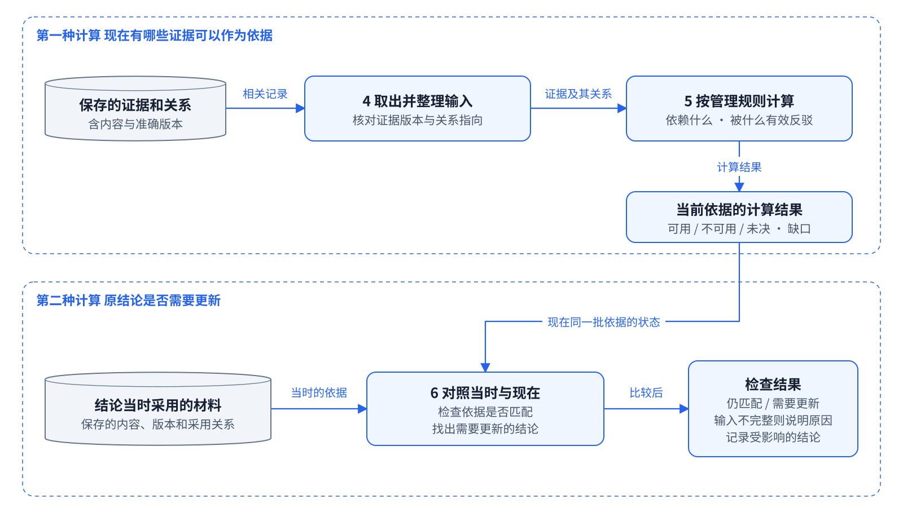
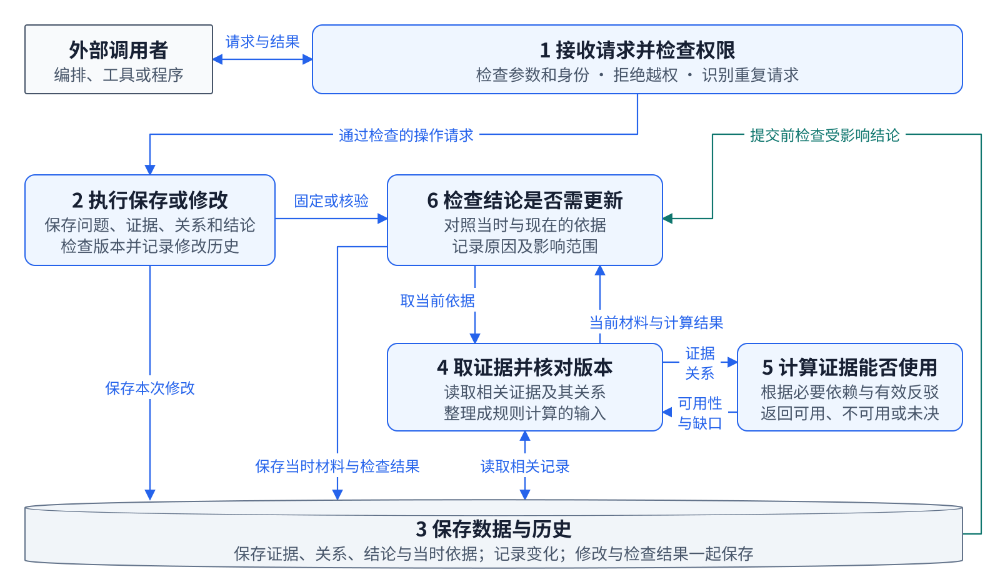

# IM 内核的模块与事务协作

本文说明 `issue_manager/` 的内部模块、证据计算和结论当前性维护，补充[系统架构](WORKFLOW_ARCHITECTURE.md)。

## 先看两种计算怎样接起来

图中优先使用“做什么”和“交出什么结果”命名，代码名称放在后面的对照表。



- **第 4 组取资料。** 从数据库取出相关证据和关系，核对版本，整理成可以计算的输入。
- **第 5 组算证据。** 按已声明的必要依赖、反驳等规则，计算哪些证据可用、哪些不可用、哪些仍未决，以及缺少哪些依据。
- **第 6 组查结论。** 拿到当前材料及计算结果，与结论当时采用的准确材料比较，找出需要更新的结论、原因和影响范围。

图的上半部分回答“现在有哪些证据可以作为依据”，下半部分回答“原结论是否需要更新”。箭头表示材料和结果的交接；实际代码中，第 5 组的结果由第 4 组整理后返回第 6 组。当前性还会检查准确版本、回执和其他相关输入；对比并不限于可用性标签是否相同。

## 1 按职责可以分为六组模块

IM 包中有多个 Python 文件和领域服务，适合按下面六组职责理解。六组是说明架构的功能划分，不是六个独立部署服务。当前内核的协作主要通过 Python 调用与同一 SQLite 连接上的事务完成；公开 HTTP 是外部进入内核的边界。



图中序号对应下表，不表示执行顺序。蓝线表示操作调用、数据读写及结果交接；青绿色线表示存储事务在提交前调用维护钩子。返回响应、各层细粒度权限检查和辅助领域服务未逐条绘制。

| 模块组 | 主要代码 | 职责 |
| --- | --- | --- |
| 1 接收请求并检查权限 | `manager_api.py`、各 `*_api.py`、`security.py` | HTTP 路由、JSON 参数校验、身份认证、能力检查、请求幂等和错误响应；将合法请求转交领域服务 |
| 2 执行保存或修改 | `service.py` 中的 `IssueManager`，以及 Evidence、关系、结论等服务 | 实现“保存贡献”“修订关系”“保存结论”等完整业务操作；检查范围与预期版本，组合领域写入、审计和回执 |
| 3 保存数据与历史 | `store.py`、`current_schema.sql`、`repositories.py` | SQLite 连接、表与索引、领域记录、不可变历史、快照和派生状态的持久化；管理事务、嵌套保存点、提交与回滚 |
| 4 取出证据并核对版本 | `context_scoped_v2_resolver.py` | 从一致数据库快照读取所需范围，固定 Evidence 与关系端点的准确版本，构造有界图；将纯算法输出转换为材料与比较输入，并记录变化订阅 |
| 5 计算证据能否使用 | `scoped_semantics.py`、`scoped_projection.py` | 按显式必要依赖和反驳关系求证据资格；围绕作者明确采用的根计算支持、缺口、争议和候选区域；算法本身不读写数据库 |
| 6 检查结论是否需要更新 | `context_maintenance_service.py`、`currentness_repository.py`、`currentness.py` | 保存冻结材料包与依据回执，比较当前输入和原采用输入，定位受影响结论，维护结论当前性及依赖传播，并持久化结果 |

`IssueManager._wire_services()` 将这些服务装配起来。各模块共享权威存储，服务可以通过 Store 或相应 Repository 访问它；当前实现并非所有 SQL 都必须经过一个统一 Repository 包装层。

## 2 证据计算和结论当前性是两类计算

### 2.1 证据规则计算

`ContextScopedV2Resolver` 读取领域记录，构造 `ScopedSnapshot`，然后调用：

```text
scoped_semantics.solve(图快照)
    → 每个 Evidence 的可用 不可用 未决状态及原因

scoped_projection.project(图快照, 明确采用根, 求解结果)
    → 必要依据范围 可用支持 缺口 相关争议 其他候选
```

例如 B 必须依赖 A，而可用的 C 有效反驳 A，规则据此计算 A、B 的资格变化。`derived_from` 说明来源，`depends_on` 才说明必要前提；解析层和规则层不代替作者猜这种关系。

算法拿到的是内存中的结构化图。读取 SQL、绑定版本和记录订阅由解析层完成。相同输入可用于冻结、预览、当前状态查询与维护，避免各入口另写一套规则。

### 2.2 结论当前性计算

一个结论还需要知道：作者当时采用了哪些材料、哪些准确版本，以及当前相关输入是否仍与当时匹配。

上下文服务为结论保存冻结材料包和依据回执。变化发生后，它通过同一解析器取得当前比较输入，检查回执资格、版本和语义输入是否匹配，再由 `CurrentnessRepository.apply()` 调用 `currentness.maintain_region()` 维护受影响区域。

这里既有单条结论的局部不匹配，也有其他结论通过 provider 关系带来的影响传播。因此，它与单个 Evidence 图中的资格求解有不同职责。

`current` 表示当前性规则下相关依据仍匹配，科学正确性由参与者判断。证据不可用、依据发生变化或输入无法完整核验，应保留对应原因，不能直接宣告相反科学命题成立。

## 3 一次领域写入怎样完成

以新增一条带必要关系的贡献为例：

1. **接口接收。** HTTP 层校验请求格式、认证和请求身份，把业务参数交给 `IssueManager`。
2. **领域检查。** 领域服务检查权限、作用范围、关系端点、版本及业务条件，在同一事务内组合贡献、关系、历史、审计和幂等回执等写入。
3. **数据库捕获变化。** 当前 schema 中的 SQL 触发器将相关输入变动记录进 `context_input_events`，同时推进输入修订时钟。它们记录变化，不执行 Python 图算法。
4. **提交前触发维护。** 最外层 `Store.transaction()` 在 commit 前调用 `before_commit`；`IssueManager` 将它绑定到 `context_maintenance.flush`。
5. **定位受影响结论。** `flush()` 消费尚未维护的输入事件，用变化前后的字段查询 `context_subscriptions` 索引，找出应重新核验的结论。
6. **解析与计算。** 解析器在同一事务快照中读取当前领域状态，调用证据规则与投影，并将比较结果、局部原因和 provider 依赖贡献交给当前性维护。
7. **共同发布。** 当前性 Repository 维护受影响区域，写回当前性、原因、索引与检查点；正常完成后，领域写入和相关维护结果一起提交。未预期异常会导致事务回滚。可识别的不完整输入必须保留错误或需更新状态，不能伪装成可认证的 current。

两个直接连接点是：

```python
# service.py 中装配服务
self.store.before_commit = self.context_maintenance.flush

# store.py 中最外层事务的提交顺序
yield self.conn
before_commit()
self.conn.commit()
```

上面第二段是提取出的主要顺序；实际代码还包含钩子存在性检查、保存点和异常回滚。

这条机制使正常写入路径在提交前完成所需维护，避免只保存了新依据，却仍向外发布未维护的旧当前性。图算法由 Python 服务执行，SQL 触发器承担变化捕获。

这里的 `context_input_events` 是内核事务中的输入变化记录，与编排层交付意图 journal、编排队列以及对外领域事件源各有职责。

## 4 一次读取怎样完成

查询 Issue 当前依据时，领域入口可调用 `current_scoped_projection()`：在只读事务中取当前结论明确采用的根，交解析器读取准确领域状态，调用规则与投影，并在检查材料读取权限后返回支持、缺口、争议和候选等信息。这条查询不会创建新材料包或视图。

读取已经保存的结论当前性时，`show()` 返回维护结果、所选回执和原因；缓存缺失或尚有未维护输入时会明确呈现待维护状态。

准备一次新结论则是另一条写入路径：先固定材料包与视图，作者读取并形成判断，再由领域事务核验预期结论 head、准确采用根和材料变化情况，保存新结论、依据回执、head、审计及幂等结果。历史快照保留原输入。

## 5 代码核对入口

- [对外 HTTP 与请求事务](../issue_manager/manager_api.py)
- [领域服务与服务装配](../issue_manager/service.py)
- [Store 事务](../issue_manager/store.py)
- [当前 schema 与 SQL 触发器](../issue_manager/current_schema.sql)
- [数据解析与准确绑定](../issue_manager/context_scoped_v2_resolver.py)
- [证据规则求解](../issue_manager/scoped_semantics.py)
- [采用根投影](../issue_manager/scoped_projection.py)
- [材料包 回执与提交前维护](../issue_manager/context_maintenance_service.py)
- [当前性持久化与区域计算](../issue_manager/currentness_repository.py)、[纯区域维护算法](../issue_manager/currentness.py)

可编辑图源：[IM 内核模块 Draw.io](figures/project_topology/IM_INTERNAL_ARCHITECTURE.drawio)、[两种计算协作 Draw.io](figures/project_topology/IM_INTERNAL_CALCULATIONS.drawio)。图示 SVG 保留可编辑文本。本文与补图只增加说明，未修改运行代码。
