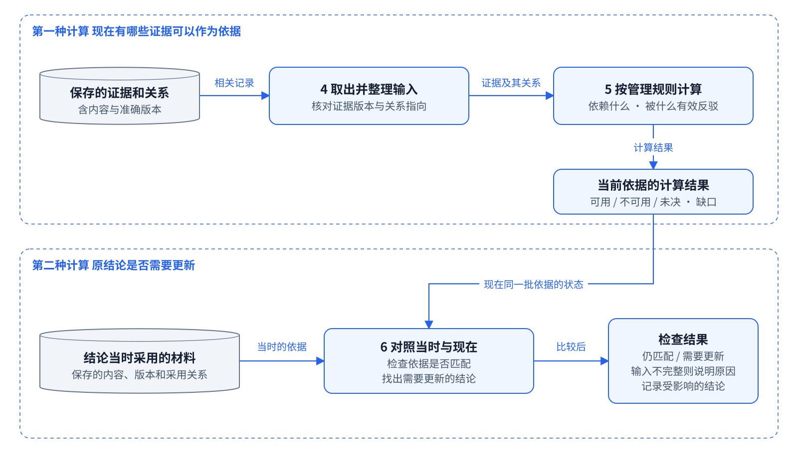
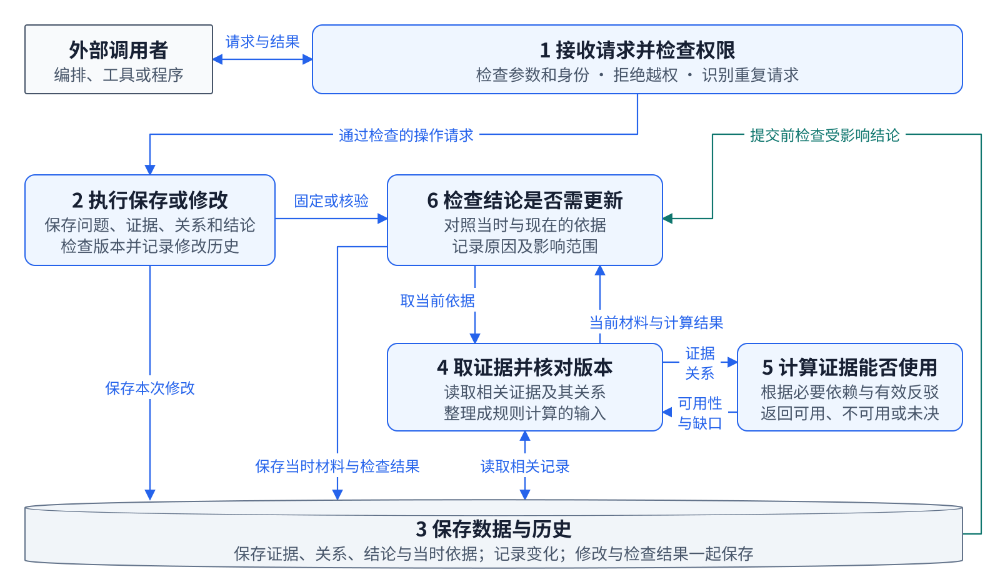

# IM kernel modules and transaction cooperation

[English documentation](README.md) · [Chinese original](../IM_INTERNAL_ARCHITECTURE.md)

This document describes the internal modules of `issue_manager/`, evidence calculation, and conclusion-currentness maintenance, supplementing the [system architecture](architecture.md).

## First: how the two calculations connect

The diagrams emphasize what each group does and returns; code names appear in the table below.



- **Group 4 retrieves materials.** Read relevant evidence and relations from the database, check versions, and prepare calculable inputs.
- **Group 5 calculates evidence.** According to declared necessary dependencies, refutations, and other rules, calculate which evidence is available, unavailable, or undecided and what basis is missing.
- **Group 6 checks conclusions.** Compare current materials and calculation results with the precise materials adopted when a conclusion was made, identifying conclusions needing updates, reasons, and affected scope.

The upper half answers “which evidence can currently be used as a basis”; the lower half asks “does the original conclusion need an update?” Arrows represent the handoff of materials and results. In code, group 4 prepares group 5's result and returns it to group 6. Currentness also checks exact versions, receipts, and other relevant inputs; comparison is not limited to whether eligibility labels match.

## 1. Six groups of responsibilities

The IM package contains multiple Python files and domain services, which can be understood in six functional groups. They are architectural groupings, not six separately deployed services. Current kernel cooperation primarily uses Python calls and transactions on one SQLite connection; public HTTP is the external boundary.



Numbers correspond to the table rather than execution order. Blue lines indicate calls, data reads and writes, and result handoffs; teal indicates storage transactions calling a maintenance hook before commit. Return responses, fine-grained permissions at each layer, and auxiliary domain services are not shown individually.

| Group | Main code | Responsibilities |
| --- | --- | --- |
| 1. Receive requests and check permissions | `manager_api.py`, `*_api.py`, `security.py` | HTTP routing, JSON validation, authentication, capability checks, request idempotency, errors; dispatch valid requests to domain services. |
| 2. Save or modify | `IssueManager` in `service.py`, Evidence, relation, and conclusion services | Complete business operations such as saving contributions, revising relations, and saving conclusions; check scope and expected versions; combine domain writes, audits, and receipts. |
| 3. Save data and history | `store.py`, `current_schema.sql`, `repositories.py` | SQLite connections, tables and indexes, domain records, immutable history, snapshots, and derived state; manage transactions, nested savepoints, commits, and rollbacks. |
| 4. Retrieve evidence and check versions | `context_scoped_v2_resolver.py` | Read the required scope from a consistent snapshot, fix exact Evidence and relation endpoint versions, construct a bounded graph, convert pure-algorithm output to material and comparison inputs, and record change subscriptions. |
| 5. Calculate evidence eligibility | `scoped_semantics.py`, `scoped_projection.py` | Solve eligibility from explicit necessary dependencies and refutations; compute support, gaps, disputes, and candidate regions around roots explicitly adopted by the author. The algorithms do not read or write the database. |
| 6. Check whether conclusions need updating | `context_maintenance_service.py`, `currentness_repository.py`, `currentness.py` | Save frozen material packages and basis receipts, compare current and adopted inputs, locate affected conclusions, maintain currentness and dependency propagation, and persist results. |

`IssueManager._wire_services()` assembles the services. Groups share authoritative storage, accessed through Store or corresponding repositories; not all SQL in the current implementation must pass through one uniform Repository wrapper.

## 2. Evidence calculation and conclusion currentness are distinct

### 2.1 Evidence rule calculation

`ContextScopedV2Resolver` reads domain records, constructs a `ScopedSnapshot`, and calls:

```text
scoped_semantics.solve(graph snapshot)
    → available, unavailable, or undecided status and reasons for each Evidence

scoped_projection.project(graph snapshot, explicitly adopted roots, solve result)
    → necessary basis scope, available support, gaps, relevant disputes, other candidates
```

For example, B necessarily depends on A and an available C effectively refutes A. The rules calculate the changed eligibility of A and B. `derived_from` expresses provenance; only `depends_on` expresses a necessary premise. Neither resolver nor rule layer guesses the relationship for the author.

The algorithm receives a structured in-memory graph. The resolver reads SQL, binds versions, and records subscriptions. The same inputs can support freezing, preview, current-state queries, and maintenance, avoiding a different rule implementation for each entry point.

### 2.2 Conclusion-currentness calculation

A conclusion also needs to know which exact materials and versions the author adopted and whether current related inputs still match them.

The context service stores a frozen material package and basis receipt for the conclusion. After changes, it uses the same resolver to obtain current comparison inputs, checks receipt eligibility, versions, and semantic inputs, and lets `CurrentnessRepository.apply()` call `currentness.maintain_region()` to maintain the affected region.

This includes local mismatch for an individual conclusion and propagation through provider relationships to other conclusions. Its responsibility therefore differs from eligibility solving within an Evidence graph.

`current` means the relevant basis still matches under the currentness rules; scientific correctness is for participants to judge. If evidence is unavailable, the basis changes, or inputs cannot be fully checked, retain the corresponding reason; do not declare the opposite scientific proposition true.

## 3. How a domain write completes

For a new contribution with a necessary relationship:

1. **Receive request.** The HTTP layer validates format, authentication, and request identity and passes business parameters to `IssueManager`.
2. **Domain checks.** Services check permissions, scope, relation endpoints, versions, and business conditions, combining contribution, relation, history, audit, and idempotency receipt writes in the same transaction.
3. **Database captures changes.** SQL triggers in the current schema record relevant input changes in `context_input_events` and advance the input revision clock. They record changes; they do not run Python graph algorithms.
4. **Maintenance before commit.** The outermost `Store.transaction()` calls `before_commit`; `IssueManager` binds it to `context_maintenance.flush`.
5. **Locate affected conclusions.** `flush()` consumes unmaintained input events and queries the `context_subscriptions` index using fields before and after the change.
6. **Resolve and calculate.** In the same transaction snapshot, the resolver reads current domain state, calls evidence rules and projection, and passes comparisons, local reasons, and provider dependency contributions to currentness maintenance.
7. **Publish together.** The currentness repository maintains the affected region and writes currentness, reasons, indexes, and checkpoints. On normal completion, domain writes and related maintenance commit together. Unexpected exceptions roll back the transaction. Recognizable incomplete input must retain an error or needs-update state, not masquerade as certifiable current.

The two direct connection points are:

```python
# Service assembly in service.py
self.store.before_commit = self.context_maintenance.flush

# Commit sequence in the outermost transaction in store.py
yield self.conn
before_commit()
self.conn.commit()
```

The second excerpt shows the main sequence; actual code also checks whether the hook exists and handles savepoints and exception rollback.

This ensures the normal write path completes required maintenance before commit instead of publishing unmaintained old currentness after saving new evidence. Python services run the graph algorithm; SQL triggers capture changes.

`context_input_events` records input changes within kernel transactions. It has a distinct responsibility from orchestration delivery-intent journals, orchestration queues, and external domain event sources.

## 4. How a read completes

For an Issue's current basis, the domain entry point may call `current_scoped_projection()`: in a read-only transaction it takes the roots explicitly adopted by the current conclusion, has the resolver read exact domain state, applies rules and projection, and after checking material read permissions returns support, gaps, disputes, and candidates. This query creates no new material package or view.

When reading saved conclusion currentness, `show()` returns the maintenance result, selected receipt, and reasons; if the cache is missing or inputs remain unmaintained, it explicitly reports a pending-maintenance state.

Preparing a new conclusion is a separate write path: fix a package and view, let the author read and form a judgment, then verify the expected conclusion head, exact adopted roots, and material changes in a domain transaction before saving the conclusion, basis receipt, head, audit, and idempotency result. Historical snapshots retain the original inputs.

## 5. Code references

- [Public HTTP and request transactions](../../issue_manager/manager_api.py)
- [Domain services and assembly](../../issue_manager/service.py)
- [Store transactions](../../issue_manager/store.py)
- [Current schema and SQL triggers](../../issue_manager/current_schema.sql)
- [Data resolution and exact binding](../../issue_manager/context_scoped_v2_resolver.py)
- [Evidence rule solving](../../issue_manager/scoped_semantics.py)
- [Adopted-root projection](../../issue_manager/scoped_projection.py)
- [Packages, receipts, and pre-commit maintenance](../../issue_manager/context_maintenance_service.py)
- [Currentness persistence and regional calculation](../../issue_manager/currentness_repository.py); [pure regional maintenance algorithm](../../issue_manager/currentness.py)

Editable sources: [IM kernel modules Draw.io](../figures/project_topology/IM_INTERNAL_ARCHITECTURE.drawio) and [two calculations Draw.io](../figures/project_topology/IM_INTERNAL_CALCULATIONS.drawio). The SVG diagrams retain editable text. This document and its illustrations describe the implementation without changing runtime code.

